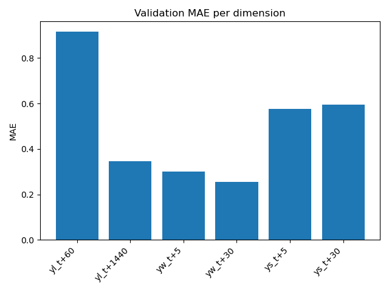

# Evaluation Report

**eval_dir:** `tmp_eval/val`

## Validation

| Metric | Value |
| --- | --- |
| MAE | 0.4980 |
| RMSE | 0.6386 |
| n_obs | 768 |

### Per dimension

| Dim | MAE | RMSE | n_obs |
| --- | --- | --- | --- |
| yl_t+60 | 0.9152 | 1.0792 | 128 |
| yl_t+1440 | 0.3469 | 0.4305 | 128 |
| yw_t+5 | 0.3015 | 0.3818 | 128 |
| yw_t+30 | 0.2545 | 0.3339 | 128 |
| ys_t+5 | 0.5759 | 0.6368 | 128 |
| ys_t+30 | 0.5940 | 0.6586 | 128 |

## PSML Test Summary

_Not found: `psml_summary/summary.json`._
